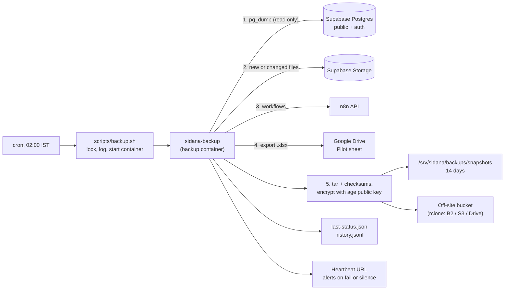

# Backups

Every night at 02:00 IST the VPS makes one encrypted snapshot of everything the platform can't rebuild. It keeps two weeks of snapshots on the server, copies each one off the server, and tells someone if a night fails or is missed.

| Part | File | Code |
|---|---|---|
| The backup job | [`deploy/backup/sidana-backup.sh`](../deploy/backup/sidana-backup.sh) | Runs inside the backup container |
| The restore test | [`deploy/backup/sidana-restore-test.sh`](../deploy/backup/sidana-restore-test.sh) | Runs inside the backup container |
| The container | [`deploy/backup/Dockerfile`](../deploy/backup/Dockerfile) | Postgres 17 tools, age, rclone, curl, jq |
| Start a backup | [`deploy/scripts/backup.sh`](../deploy/scripts/backup.sh) | Cron calls this |
| Start a restore test | [`deploy/scripts/restore-test.sh`](../deploy/scripts/restore-test.sh) | You run this over SSH |
| Settings | [`deploy/backup.env.example`](../deploy/backup.env.example) | Copied to `/srv/sidana/backup.env` |
| Automated test | [`tests/backup/run.sh`](../tests/backup/run.sh) | Runs in CI on every pull request |

## What is backed up

| What | Why it matters | How |
|---|---|---|
| **Database, `public` schema** | Startups, profiles, financials, weekly reports, notifications, the pipeline mirror | `pg_dump` |
| **Database, `auth` schema** | Every founder and team login, with password hashes | `pg_dump`, in the same call as `public` |
| **Supabase Storage files** | Founder logos, MIS and financials uploads, and decks later | Downloaded file by file through the Storage API |
| **n8n workflows** | The automation itself. If a workflow is broken or deleted, there's no other copy | n8n API. Optional |
| **The Pilot sheet** | The agents' source of truth for deal data | Google Drive export to `.xlsx`, all tabs. Optional |

Not backed up, so keep these in a password manager or know how to recreate them:
- The settings files `app.env`, `backup.env` and `.env`.
- n8n credentials. The API never returns them, so they're re-entered by hand after an import.
- Supabase dashboard settings: email templates, auth providers and redirect URLs.
- HTTPS certificates. They're issued again automatically.

## How a night's backup works



Step by step:

1. **Lock and start.** [`backup.sh`](../deploy/scripts/backup.sh) takes a lock, so two runs can never overlap. It builds the backup image (only the first time, it's cached after that) and starts the container as the `deploy` user. Everything the job prints is added to `backups/backup.log`.
2. **Settings check.** Before touching anything, the job checks it has the settings it needs, including a valid encryption key. A missing setting fails the run straight away, which sets off the alert. A silent half-backup isn't possible.
3. **Database.** The job counts the rows in every table, runs **one** `pg_dump` of the `public` and `auth` schemas, then counts again.
   - **One call:** both schemas come from the same instant, so logins and data always match.
   - **Two counts:** founders and n8n may write during the dump. The restore test accepts any count between the two.
   - **Format:** the dump uses Postgres's custom format. It's compressed, and single tables can be restored from it.
   - **Readable copy:** a plain-SQL copy of the `public` schema goes in as well, so you can read what's live.
4. **Storage files.** The job lists every file from `storage.objects` and downloads it with the service-role key.
   - **The mirror:** it keeps a copy of every file in `backups/storage-mirror`, so each night only new or changed files are downloaded. A file deleted in Supabase leaves the mirror, but older snapshots still have it.
   - **Failures:** if any download fails, the run still finishes and is still copied off the server, but it's marked failed and you're alerted.
5. **n8n and the Pilot sheet,** if they're set up.
   - **n8n:** the job reads every workflow from the n8n API.
   - **Pilot sheet:** it signs in to Google as a service account that has read-only access, and exports the whole spreadsheet.
6. **Pack and encrypt.** The job writes a manifest and SHA-256 checksums, packs everything into one tar file, and encrypts it with [age](https://age-encryption.org) to your **public** key. The result is `snapshots/sidana-2026-11-13T2030Z.tar.age`.
7. **Copy off the server.** rclone uploads the file, then the job checks the off-site copy is the same size.
8. **Clean up.** Snapshots older than `BACKUP_KEEP_DAYS` are deleted, but **only after a fully good night**. A week of failures can never empty the folder.
9. **Report.**
   - **Status files:** the job writes `backups/last-status.json` and adds a line to `backups/history.jsonl`. The developer panel will read these.
   - **Heartbeat:** it pings the heartbeat URL with `OK` or `/fail` and the reason. If no ping arrives at all, because the VPS is down or cron broke, the heartbeat service alerts on the silence.

A snapshot contains:

```
db.dump               public + auth, pg_dump custom format
schema-public.sql     the public schema, readable
counts.tsv            table, rows before the dump, rows after
storage.tar           bucket/path/file for every Storage file
storage-manifest.tsv  bucket, path, size
n8n-workflows.json    if set up
pilot-sheet.xlsx      if set up
manifest.json         when it was taken and which parts worked
SHA256SUMS
```

A sample `last-status.json`:

```json
{
  "ok": true,
  "started_at": "2026-11-13T20:30:01Z",
  "finished_at": "2026-11-13T20:30:42Z",
  "duration_s": 41,
  "snapshot": { "file": "sidana-2026-11-13T2030Z.tar.age", "bytes": 4183920 },
  "last_success_at": "2026-11-13T20:30:42Z",
  "parts": {
    "database": "ok",
    "storage": { "state": "ok", "files": 212 },
    "n8n": { "state": "ok", "workflows": 14 },
    "pilot_sheet": "ok",
    "offsite": "ok"
  },
  "problems": []
}
```

## Why it's built this way

- **Encrypted to a public key.** The server holds only the public key (`age1...`), which can lock but not unlock. The private key lives with you, in a password manager. Someone who breaks into the VPS can't read old snapshots, and neither can someone who gets into the off-site bucket.
  - **Keep two copies of the private key.** Without it, the backups can't be opened by anyone. Better still, add a second person's public key, so either of you can restore.
- **Off-site.** A copy that sits only on the VPS dies with the VPS.
  - **Delete-proof:** give the off-site key **no delete permission** and let the bucket's own lifecycle rule remove old copies. Then even a hacked server can't wipe them.
- **A container.** The tools are the same on every machine, nothing is installed on the VPS, and the job can't touch the app.
- **Read-only.** The job never writes to Supabase, n8n or Google. That's in line with the rule that agent data is never overwritten.
- **Tested.** On every pull request, CI builds the real image and runs [`tests/backup/run.sh`](../tests/backup/run.sh) against a fake Supabase.
  - **What it runs:** a backup, a restore test from the local copy, a restore test from the off-site copy, a check that a wrong key is refused, a partial Storage failure, and a run with missing settings.

## One-time setup

The files reach the VPS with the next release after this is merged, because the deploy workflow copies `deploy/` to `/srv/sidana`.

### 1. Make your encryption key, on your own computer

```bash
brew install age
```

```bash
age-keygen -o sidana-backup-key.txt
```

1. Save the whole file in your password manager. It holds the line starting `AGE-SECRET-KEY-`.
2. Keep a second copy somewhere offline.
3. The printed `Public key: age1...` is what goes on the server.

### 2. Get the database address

In Supabase, go to **Connect**, then **Session pooler**, and copy the URI with the database password filled in.

### 3. Create the off-site bucket

**Backblaze B2** is the simplest and cheapest option. The first 10 GB are free, then about $6 per TB per month.

1. Create a **private** bucket, for example `sidana-backups`.
2. Under **Lifecycle settings**, choose a custom rule: hide files 90 days after upload and delete them 1 day after hiding.
3. Under **Application Keys**, create a key for **this bucket only**, with read and write but **no delete**. Copy the key ID and the key.

Any rclone backend works, including S3, Cloudflare R2 and Google Drive. Set the matching `RCLONE_CONFIG_OFFSITE_*` lines.

### 4. Set up the heartbeat alert

On [healthchecks.io](https://healthchecks.io) (the free tier is enough):

1. Create a check with a period of **1 day** and a grace of **2 hours**.
2. Add email, Slack or WhatsApp alerts.
3. Copy its ping URL.

### 5. Optional extras

- **n8n:** in n8n, go to **Settings**, then **n8n API**, and create an API key.
- **Pilot sheet:**
  1. In Google Cloud, create a project and enable the **Google Drive API**.
  2. Create a **service account** and add a JSON key to it.
  3. Share the Pilot sheet with the service account's email as a **Viewer**.
  4. Put the JSON in `backup.env` as one line of base64: `base64 -i key.json | tr -d '\n'`.

### 6. Fill in `backup.env` on the VPS

The deploy workflow doesn't copy `.example` files, so send the template up from your computer first:

```bash
scp deploy/backup.env.example deploy@<vps>:/srv/sidana/backup.env
```

```bash
ssh deploy@<vps> 'chmod 600 /srv/sidana/backup.env && nano /srv/sidana/backup.env'
```

### 7. Run it once by hand

```bash
/srv/sidana/scripts/backup.sh
```

```bash
cat /srv/sidana/backups/last-status.json
```

### 8. Prove it restores, from your own computer

```bash
ssh deploy@<vps> /srv/sidana/scripts/restore-test.sh offsite < sidana-backup-key.txt
```

The key travels over SSH on stdin and is only ever held in memory on the server. The script downloads the newest off-site copy, decrypts it and checks every checksum. It then restores the database into a throwaway Postgres inside the container, compares every table's row count, checks the files, the workflows and the sheet, and deletes everything it made. It ends with `RESTORE TEST PASSED`.

### 9. Schedule it

On the VPS, run `crontab -e` as `deploy` and add this line. It runs at 02:00 IST when the server clock is on UTC.

```
30 20 * * * /srv/sidana/scripts/backup.sh > /dev/null 2>&1
```

## Day to day

| Task | Command, on the VPS from `/srv/sidana` |
|---|---|
| Did last night work? | `cat backups/last-status.json` |
| The last 30 runs | `tail -n 30 backups/history.jsonl` |
| Full log | `less backups/backup.log` |
| Back up now | `./scripts/backup.sh` |
| List snapshots | `ls -lh backups/snapshots` |
| Disk used | `du -sh backups` |

Run the restore test from step 8 **once a month**, and after any change to the database or the backup settings.

**If Supabase upgrades to Postgres 18**, change `postgres:17-alpine` to `postgres:18-alpine` in the [Dockerfile](../deploy/backup/Dockerfile). `pg_dump` must be at least as new as the database.

## Restoring for real

Every restore is a person's decision and needs approval. **Never restore over the live database to fix a few rows.** Start by opening a snapshot on your own computer:

```bash
age -d -i sidana-backup-key.txt sidana-2026-11-13T2030Z.tar.age | tar -x -C restored/
```

```bash
pg_restore --list restored/db.dump | less
```

### A few rows or one table went wrong

Restore into a scratch database, look at the old rows, and copy back only what's needed with reviewed SQL.

```bash
createdb scratch && pg_restore --no-owner --no-privileges -d scratch restored/db.dump
```

### A founder's file was deleted or overwritten

```bash
tar -xf restored/storage.tar ./startup-logos/123/logo.png
```

Upload it again from the admin panel, or from Supabase under **Storage**.

### The Supabase project is lost

1. Create a new project and run the migrations in `MIGRATIONS/` in order. That recreates the buckets.
2. Restore the logins first. Supabase creates the `auth` tables itself, so restore only their rows:

```bash
pg_restore --data-only --schema=auth -f auth-data.sql restored/db.dump
```

```bash
psql "$NEW_DB_URL" -c "set session_replication_role = replica" -f auth-data.sql
```

   If Supabase's auth version has changed since the backup, a column may differ. Fix those lines in `auth-data.sql` before running it.

3. Restore the platform's data:

```bash
pg_restore --no-owner --no-privileges --schema=public -d "$NEW_DB_URL" restored/db.dump
```

4. Upload the files. Unpack `storage.tar`, then copy each bucket folder up using Supabase's S3 connection: **Storage**, **S3 Connection**, then an `rclone copy`.
5. Put the new URL and keys in `app.env` and on GitHub, then release again. Passwords still work. Everyone is signed out once.

### The VPS is lost

Supabase isn't affected. Set up a new VPS with [`deploy/README.md`](../deploy/README.md). The off-site copies are untouched. Copy `backup.env` back, then run the restore test against `offsite`.

### The Pilot sheet was damaged

Try Google Sheets' own **version history** first. If that isn't enough, open `pilot-sheet.xlsx` from the snapshot and copy the needed values back **by hand**, filling only empty cells and reporting any conflicts. Never paste a whole tab over the agents' live sheet.

### An n8n workflow was broken or deleted

```bash
jq '.[] | select(.name == "Pilot sync")' restored/n8n-workflows.json > workflow.json
```

Import it in n8n with **Import from file**, then connect its credentials again.

## Space and cost

The snapshot size is roughly the compressed database plus all Storage files. Each snapshot holds the full set of files, so a restore needs only one file.

For example, a 20 MB database with 500 MB of files gives snapshots of about 520 MB. Fourteen of them, plus the mirror, take about 8 GB on the VPS. Ninety days off-site take about 47 GB, or about $0.25 a month on B2. If files grow into many GB, lower `BACKUP_KEEP_DAYS` or move to snapshots that only store changes.

## What it doesn't do yet

- **Point-in-time recovery.** Snapshots are nightly, so up to a day of changes can be lost. Supabase's PITR add-on gives minute-level recovery if that matters.
- **A record of applied migrations.** It's still unclear which migrations are live, so `schema-public.sql` in each snapshot is the best record for now.
- **The developer panel.** It will show `last-status.json` and `history.jsonl`. The format is fixed above.
