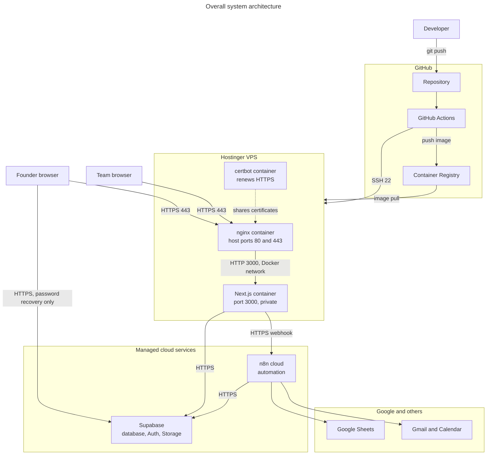

# System architecture

## The big picture

**Reading this diagram:**
- **Visitors → nginx:** every visitor enters through nginx on port 443. Port 80 only redirects to HTTPS or answers certificate checks.
- **nginx → Next.js:** this hop uses plain HTTP on port 3000, inside a private Docker network that the internet can't reach.
- **Next.js → Supabase:** this is where almost all reading and saving happens, using server-side code.
- **Browser → Supabase:** a few password screens talk to Supabase directly.
- **Next.js → n8n:** the app only calls n8n for admin broadcasts and contact sync.
- **n8n → Supabase and Google:** n8n runs on its own schedules, so most of the portal's data arrives without the app being involved.
- **GitHub → VPS:** a release builds an image, then connects over SSH to start it.

Ports for Supabase and n8n are shown as HTTPS without a number, because they're addressed by `https://` URLs and the port isn't set in any config. See [networking and ports](10-NETWORKING-AND-PORTS.md).

## What each part is, and what happens if it fails

| Part | Why Sidana uses it | If it fails | Look at first |
|---|---|---|---|
| **nginx** | One secure entrance with HTTPS and rate limits | The site is unreachable | [nginx config](../../deploy/nginx/snippets/app.conf), `./scripts/dc.sh logs nginx` |
| **Next.js** | Pages and server logic in one app | nginx shows "back in a moment", and Docker restarts it | `./scripts/dc.sh logs app` |
| **Supabase** | Managed database and logins | Signed-in pages show an error or the last good copy | `/api/health?deep=1`, Supabase dashboard |
| **n8n** | Automates the deal work without app code | Data stops updating and admin emails fail; pages still load | n8n executions list |
| **Google Sheets** | The team's working data | n8n syncs stop; the portal shows older data | n8n executions list |
| **GitHub Actions** | Tests and releases code | No new releases; the live site keeps running | Actions tab |
| **certbot** | Renews certificates | Nothing at first; HTTPS expires after the certificate's end date | `./scripts/dc.sh logs certbot` |

## Key design decisions

| Decision | Why | Trade-off |
|---|---|---|
| Next.js full-stack, no separate backend | Less code for a small team | No API yet for a mobile app or partners |
| One app container | Next.js keeps its cache inside one process | The server is a single point of failure |
| Data lives outside the VPS | The server can be rebuilt without losing data | Depends on Supabase being up |
| Founder input goes to its own tables | Founders can't overwrite the team's records | The team has to review changes |
| Images built in CI | The server never needs source code | Releases depend on GitHub |

The app is a **three-tier design deployed as a monolith**: a browser layer, a Next.js layer and a Supabase data layer, with one codebase and one deployable.
