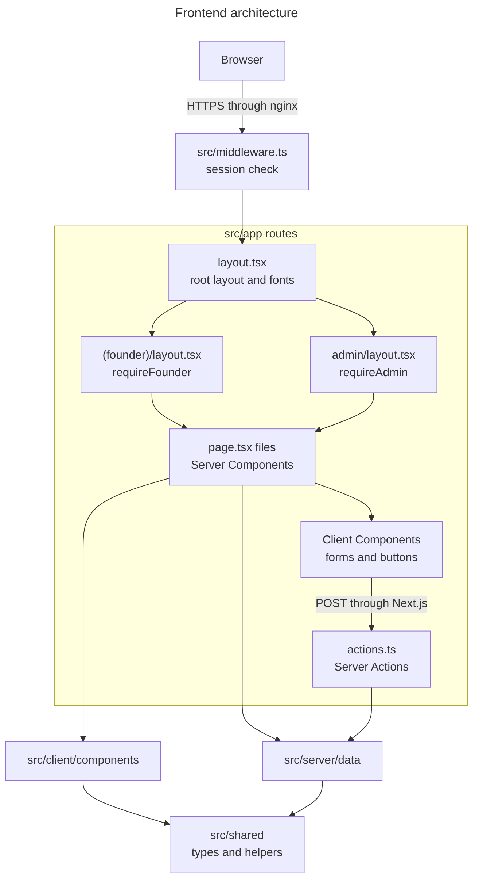

# Frontend architecture

**What it is:** the screens people use, built with Next.js 15 App Router, React 19, TypeScript and Tailwind CSS.

## Folder map

| Path | Responsibility |
|---|---|
| [`src/app`](../../src/app) | Routes. Each folder is a URL, and `page.tsx` is what it shows |
| [`src/client/components`](../../src/client/components) | Shared UI, grouped by area |
| [`src/client/lib`](../../src/client/lib) | Browser Supabase client and font setup |
| [`src/shared`](../../src/shared) | Types and helpers that are safe in the browser and on the server |
| [`src/fonts`](../../src/fonts) | Font files, kept in the repo so builds don't depend on Google |
| [`public/images`](../../public/images) | Logos |

**Doesn't exist yet:** `src/client/hooks`, `src/client/services`, a `src/client/features` folder or a frontend API client. The one React context is [`home-context.tsx`](../../src/client/components/home/home-context.tsx), and it only serves the homepage.

### Component groups

| Folder | Used by |
|---|---|
| `components/founder` | Founder portal: shell, navigation, cards, tabs |
| `components/admin` | Admin panel: shell, sidebar, tables, charts |
| `components/home` | Public homepage |
| `components/site` | Sign-in page layout |
| `components/announcements` | Announcement popup and bell |
| `components/layout` | Navigation lists, plus unused older files |
| `components/ui` | Badges, links and auto-refresh, plus unused older files |

**Unused and safe to review for removal:** `layout/shell.tsx`, `layout/sidebar.tsx`, `layout/topbar.tsx`, `ui/bar-chart.tsx`, `ui/card.tsx`, `ui/table.tsx`.

**A naming trap:** "client" in `src/client` means the UI layer, not browser-only code. Most of those components run on the server. Only files that start with `"use client"` run in the browser.

## Pages

There are 31 pages.

| Area | URLs | Access |
|---|---|---|
| Public | `/`, `/login`, `/teamonly`, `/forgot-password`, `/reset-password` | Anyone |
| Password change | `/force-reset` | Signed-in users who must change a temporary password |
| Founder | `/dashboard`, `/business-details`, `/complete-profile`, `/pitch-deck`, `/financials`, `/funding`, `/meetings`, `/weekly-reports`, `/profile`, `/settings` | `requireFounder()` |
| Admin | `/admin` and 14 pages under it | `requireAdmin()` |

Navigation lists are in [`nav.ts`](../../src/client/components/layout/nav.ts). `(founder)` is a route group: the parentheses mean it groups pages without adding to the URL.

## How the frontend fits together

**Reading this diagram:**
- **Middleware** runs first on nearly every request and checks whether there's a valid session.
- **Layouts** wrap pages with shared UI and their own access check.
- **Pages** run on the server, check access again and load data directly, without calling an API.
- **Client Components** handle typing and clicking, then call Server Actions to save.

## Server and Client Components

| | Server Component (default) | Client Component (`"use client"`) |
|---|---|---|
| Runs | On the server | In the browser, after a first server render |
| Can read the database | Yes | Never |
| Can react to clicks | No | Yes |
| Example | [`weekly-reports/page.tsx`](../../src/app/(founder)/weekly-reports/page.tsx) | [`profile-form.tsx`](../../src/app/(founder)/complete-profile/profile-form.tsx) |

## Loading, error and empty states

| State | Where |
|---|---|
| Loading | `(founder)/loading.tsx`, `admin/loading.tsx` |
| Failure | [`app/error.tsx`](../../src/app/error.tsx), with a "Try again" button |
| Root layout failure | [`app/global-error.tsx`](../../src/app/global-error.tsx) |
| Not found | [`app/not-found.tsx`](../../src/app/not-found.tsx) |
| Empty | `EmptyState` components in `founder/ui.tsx` and `admin/ui/table.tsx` |

## Troubleshooting

| Symptom | Check |
|---|---|
| Page looks unstyled | [`tailwind.config.ts`](../../tailwind.config.ts) `content` paths must include any new folder |
| "Server component can't use hooks" | Add `"use client"`, or move the interactive part into a child component |
| Boundary test fails | See [`architecture-boundaries.test.ts`](../../tests/unit/architecture-boundaries.test.ts) |
