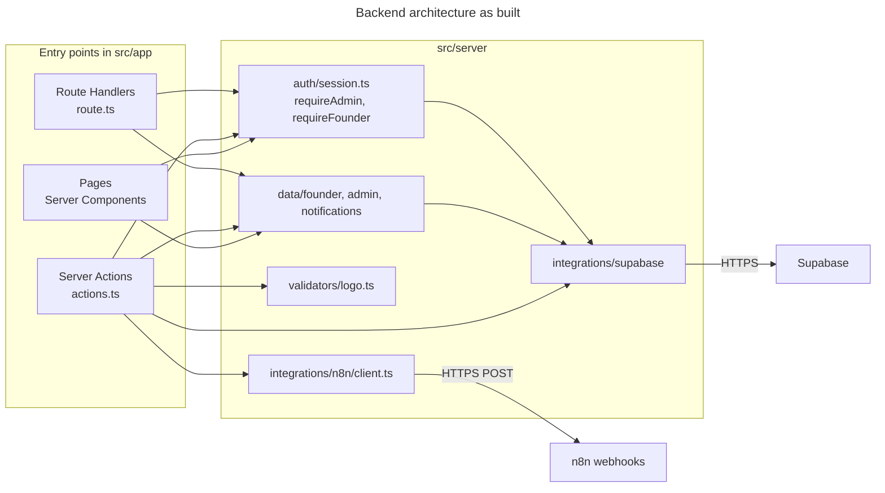
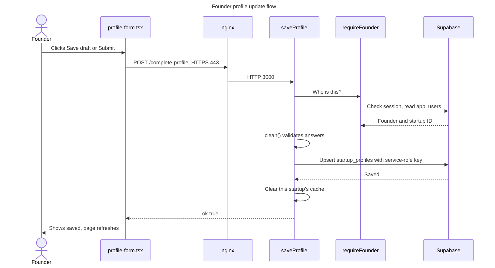

# Backend architecture

**The most important fact:** there's no separate backend server. Backend code runs inside the Next.js server. The controller, service and repository layers are planned, but **they haven't been built**.

## Today's layout

| Path | Responsibility |
|---|---|
| [`src/middleware.ts`](../../src/middleware.ts) | Session refresh and signed-out redirects |
| [`src/instrumentation.ts`](../../src/instrumentation.ts) | Checks required settings at startup |
| [`src/server/auth`](../../src/server/auth) | Session and role checks, founder login ID helpers |
| [`src/server/data`](../../src/server/data) | Database reads, currently mixed with business rules. Temporary |
| [`src/server/integrations`](../../src/server/integrations) | Supabase clients and the n8n client |
| [`src/server/config`](../../src/server/config) | Cache settings and required settings |
| [`src/server/validators`](../../src/server/validators) | Logo file checks |
| `src/app/**/actions.ts` | Server Actions: all saving, plus some business logic |
| `src/app/**/route.ts` | The three HTTP routes |

### How requests reach the backend

| Mechanism | Used for | Count |
|---|---|---|
| Server Components | Reading data for a page | Most pages |
| Server Actions | Saving data | 15 actions |
| Route Handlers | Plain HTTP endpoints | 3 |

### HTTP routes

| Route | Method | Purpose | Access |
|---|---|---|---|
| `/api/health` | GET | Health check. `?deep=1` also tests Supabase | Public |
| `/api/founder/logo` | GET | Sends the signed-in founder's own logo | Founder session |
| `/auth/signout` | POST | Ends the session | Current session |

### Server Actions

| File | Actions | Check |
|---|---|---|
| `(founder)/complete-profile/actions.ts` | `saveProfile` | `requireFounder` |
| `(founder)/profile/actions.ts` | `uploadLogo`, `removeLogo` | `requireFounder` |
| `actions/announcements.ts` | `dismissAnnouncements` | `getSessionUser` |
| `admin/announcements/actions.ts` | `createAnnouncement`, `setAnnouncementActive`, `deleteAnnouncement` | `requireAdmin` |
| `admin/notifications/actions.ts` | `sendBroadcast`, `sendTestEmail`, `syncContactsNow` | `requireAdmin` |
| `admin/profiles/actions.ts` | `reviewProfile` | `requireAdmin` |
| `admin/users/actions.ts` | `resetUserPassword` | `requireAdmin` |
| `force-reset/actions.ts` | `completeForcedReset` | `auth.getUser` |
| `login/actions.ts` | `signInTeam`, `signInFounder` | Password check |

## Backend architecture diagram

**Reading this diagram:**
- **Entry points:** pages, actions and routes are where a request enters the server.
- **Auth:** each entry point checks the user itself.
- **Data:** reads go through `server/data`, but 22 database calls still sit directly in Server Actions. The refactor will move them.
- **Integrations:** only `integrations/` talks to Supabase and n8n.

### Planned flow, not yet built

Route Handler → Controller → Service → Repository → Supabase. Saves would use new API routes, and pages would call services directly. See the plan in [`AUDIT-AND-MIGRATION-PLAN.md`](../architecture/AUDIT-AND-MIGRATION-PLAN.md).

## Validation and errors

| Concern | How it works today |
|---|---|
| **Admin input** | zod schemas inside `actions.ts` files |
| **Profile answers** | `clean()` in [`complete-profile/actions.ts`](../../src/app/(founder)/complete-profile/actions.ts) |
| **Logo files** | File type read from the bytes in [`validators/logo.ts`](../../src/server/validators/logo.ts) |
| **Failed founder reads** | `ok()` in [`data/founder.ts`](../../src/server/data/founder.ts) throws, so a failure is never cached as "no data" |
| **Failed admin reads** | Still show as blanks, and a reload fixes them. A known gap |
| **Hung connections** | [`resilient-fetch.ts`](../../src/server/integrations/supabase/resilient-fetch.ts): 15-second timeout, and reads retry once |
| **Action errors** | Actions return `{ ok: false, error }` for the form to show |

## Request walk-throughs

### A founder signs in

1. [`login/page.tsx:33`](../../src/app/login/page.tsx) submits the form to `signInFounder`.
2. nginx allows 10 sign-in POSTs a minute per IP, with a burst of 10.
3. [`login/actions.ts:60`](../../src/app/login/actions.ts) turns the email or Login ID into a startup ID. Emails are looked up in `startup_contacts`.
4. It signs in to Supabase with the startup's internal login email and the password, which sets session cookies.
5. `finishLogin` reads the role from `app_users` and redirects to `/dashboard`.

The diagram is in [authentication and security](12-AUTHENTICATION-AND-SECURITY.md).

### A founder updates their profile

**Reading this diagram:** the form is in [`profile-form.tsx:63`](../../src/app/(founder)/complete-profile/profile-form.tsx), and the action is in [`complete-profile/actions.ts:66`](../../src/app/(founder)/complete-profile/actions.ts). The startup ID comes from the verified session, never from the browser. Answers go to `startup_profiles` for team review, so `startups` and the Pilot sheet aren't touched. Reviews go through `reviewProfile`, in [`admin/profiles/actions.ts`](../../src/app/admin/profiles/actions.ts).

### An admin publishes an announcement

1. [`announcement-form.tsx:24`](../../src/app/admin/announcements/announcement-form.tsx) calls `createAnnouncement`.
2. [`admin/announcements/actions.ts:29`](../../src/app/admin/announcements/actions.ts) runs `requireAdmin`, then validates with zod.
3. It inserts a row into `announcements`. **n8n isn't involved.**
4. Each layout then loads it through `getAnnouncementsForUser` in [`data/notifications.ts`](../../src/server/data/notifications.ts).
5. Dismissing the popup calls `dismissAnnouncements`, which saves a row per user.

The admin email broadcast is different, because it uses n8n. See [n8n and integrations](05-N8N-AND-INTEGRATIONS.md).

## Caching

Founder reads pass through `founderCache` in [`data/founder.ts`](../../src/server/data/founder.ts). Results are kept for 60 seconds per startup ([`cache-tags.ts`](../../src/server/config/cache-tags.ts)), and an expired copy is re-read rather than served. A founder's own save clears their cache at once. Changes from n8n appear after the cache expires.
