# Database and Supabase

**What it is:** Supabase is a hosted service that provides a PostgreSQL database, user logins (Auth), file storage and a REST API over the database (PostgREST).

**Why Sidana uses it:** the team doesn't have to run a database server, and n8n and the app can share the same data.

## Evidence limits

**The live schema couldn't be read for this study.** This document is based on:
- [`MIGRATIONS`](../../MIGRATIONS) SQL files, which cover only the tables the portal added
- hand-written types in [`src/shared/types/db.ts`](../../src/shared/types/db.ts)
- queries in the application code

The core tables (`startups`, `investors`, `matches`, `meetings`, `funding_rounds`, `docs`, `app_users`, `mail_log`) have no migration in this repo, so their real constraints are **not verified**. Plan and region are **needs admin**.

## Three ways the app connects

| Client | File | Key | Where it runs | Used for |
|---|---|---|---|---|
| Browser | [`client/lib/supabase.ts`](../../src/client/lib/supabase.ts) | Public anon key | Browser | Forgot password, reset password, change password |
| Server | [`integrations/supabase/server.ts`](../../src/server/integrations/supabase/server.ts) | Anon key plus the user's cookies | Next.js server | Sign-in, session checks |
| Service role | [`integrations/supabase/admin.ts`](../../src/server/integrations/supabase/admin.ts) | Service-role key | Next.js server only | Nearly all reading and saving |

**Why this matters:** the service-role key **bypasses database security rules**. For almost all app queries, the protection is the application's own checks, such as filtering by the verified `startupId`.

## Data model

```mermaid
---
title: Partial database ER diagram, from migrations and queries
---
erDiagram
    startups ||--o{ matches : "startup_id"
    investors ||--o{ matches : "investor_id"
    startups ||--o{ meetings : "startup_id"
    investors ||--o{ meetings : "investor_id"
    startups ||--o{ funding_rounds : "startup_id"
    startups ||--o{ docs : "startup_id"
    investors ||--o{ docs : "investor_id"
    startups ||--o{ app_users : "startup_id"
    startups ||--o{ startup_contacts : "startup_id"
    startups ||--o| startup_profiles : "startup_id"
    startups ||--o| startup_decks : "startup_id"
    startups ||--o| startup_branding : "startup_id"
    startups ||--o{ weekly_reports : "startup_id"
    startups ||--o{ mail_log : "startup_id"
    investors ||--o{ mail_log : "investor_id"
    email_broadcasts ||--o{ email_broadcast_recipients : "broadcast_id FK"
    announcements ||--o{ announcement_dismissals : "announcement_id FK"

    startups {
        bigint id PK
        text name
    }
    investors {
        bigint id PK
        text name
    }
    matches {
        bigint id PK
        bigint startup_id
        bigint investor_id
        text state
    }
    meetings {
        bigint id PK
        bigint startup_id
        bigint investor_id
        timestamptz scheduled_at
    }
    app_users {
        uuid id PK
        text role
        bigint startup_id
        boolean active
    }
    startup_profiles {
        bigint startup_id PK
        jsonb answers
        jsonb approved_answers
        text status
    }
    weekly_reports {
        bigint id PK
        bigint startup_id
        date week_start
        text source
    }
    email_broadcasts {
        bigint id PK
        text subject
        text status
    }
    email_broadcast_recipients {
        bigint id PK
        bigint broadcast_id FK
        text status
    }
    announcements {
        bigint id PK
        text title
        boolean is_active
    }
    announcement_dismissals {
        bigint announcement_id FK
        uuid user_id
    }
```

**Reading this diagram:**
- **Marked "FK":** these two links are real foreign keys in [`notifications.sql`](../../MIGRATIONS/notifications.sql).
- **`matches`, `meetings`, `docs` to `startups` and `investors`:** queries join these tables through PostgREST (for example `startup:startups(name)` in [`data/admin.ts`](../../src/server/data/admin.ts)), which requires a foreign key, so it's strong evidence.
- **Everything else:** inferred from `startup_id` and `investor_id` columns. The portal's own migrations deliberately add **no** foreign key to `startups`.
- **`app_users.id`:** matches the Supabase Auth user ID, according to the comment in `db.ts`.

The app also has no founder table of its own. A founder is an `app_users` row with `role = founder` and a `startup_id`.

## Tables and who writes them

| Table | Purpose | Written by | Migration |
|---|---|---|---|
| `startups`, `investors` | The book of startups and investors | n8n `SYNC-BOOK` | None here |
| `matches`, `funding_rounds`, `docs` | Deal data | Not verified | None here |
| `meetings` | Meetings | n8n `CAL-SYNC` (from its name) | None here |
| `mail_log` | Mirror of team mailboxes | n8n `MAIL-HISTORY` | None here |
| `app_users` | Roles and links to startups | Provisioning scripts | None here |
| `startup_contacts`, `contact_sync_runs` | Founder emails | n8n `SYNC-CONTACTS` | `notifications.sql` |
| `startup_decks` | Pitch deck links | n8n `SYNC-DECKS` | `startup-decks.sql` |
| `weekly_reports` | Weekly reports | n8n `Weekly Founder Update`, backfill script | `weekly-reports.sql` |
| `startup_profiles` | Founder answers and reviews | App | `startup-profiles.sql` |
| `startup_branding` | Logo details | App | `startup-branding.sql` |
| `announcements`, `announcement_dismissals` | Announcements | App | `notifications.sql` |
| `email_broadcasts`, `email_broadcast_recipients` | Email history | App, plus n8n `ADMIN-BROADCAST` | `notifications.sql` |

## Row Level Security (RLS)

RLS is a set of database rules that decides which rows a logged-in user can read.

| Fact | Evidence |
|---|---|
| Portal-added tables enable RLS with no anon or authenticated policies | Config: migrations |
| [`PROPOSED-rls.sql`](../../MIGRATIONS/PROPOSED-rls.sql) proposes rules for core tables. Its name says proposed | Config |
| Earlier checks with the public key returned 0 rows or an error on 9 tables | Observed on 30 October, re-check before relying on it |
| What a **signed-in founder's** token can read | **Not verified** |

## Functions, triggers and storage

| Item | Detail | Evidence |
|---|---|---|
| Trigger | `weekly_reports_touch` updates `updated_at` | Config: `weekly-reports.sql` |
| Proposed functions | `current_startup_id()`, `is_admin()`. Whether applied is unknown | Config: `PROPOSED-rls.sql` |
| Storage bucket | `startup-logos`, private, served through `/api/founder/logo` | Config: `startup-branding.sql` |

## Environment variables (names only)

| Name | Visible to browser | Purpose |
|---|---|---|
| `NEXT_PUBLIC_SUPABASE_URL` | Yes | Project address |
| `NEXT_PUBLIC_SUPABASE_ANON_KEY` | Yes, public by design | Public key |
| `SUPABASE_SERVICE_ROLE_KEY` | **Never** | Full-access key |
| `SUPABASE_DB_URL` | Never | Used only by the nightly backup, in `backup.env` ([BACKUPS.md](../BACKUPS.md)) |

## Rules for developers

1. Never overwrite data written by the agents, and never write `startups` from founder input.
2. Filter every founder query by the verified `startupId`.
3. Don't apply schema changes from the app. A person runs migrations in the Supabase SQL Editor.
4. Don't test against real Supabase. Use `npm run dev`, which uses the fake services.
