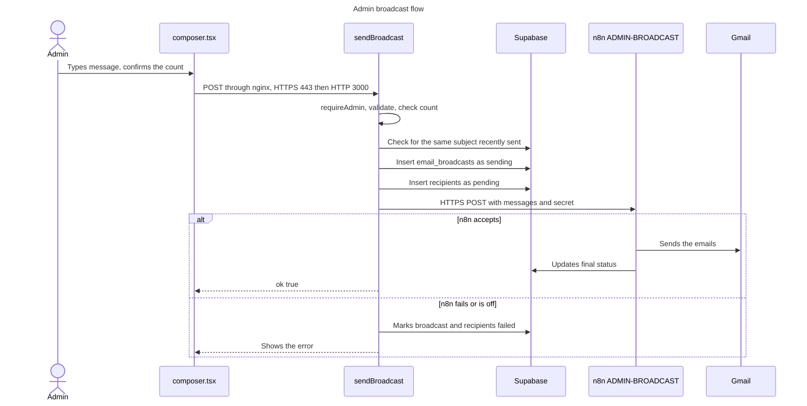
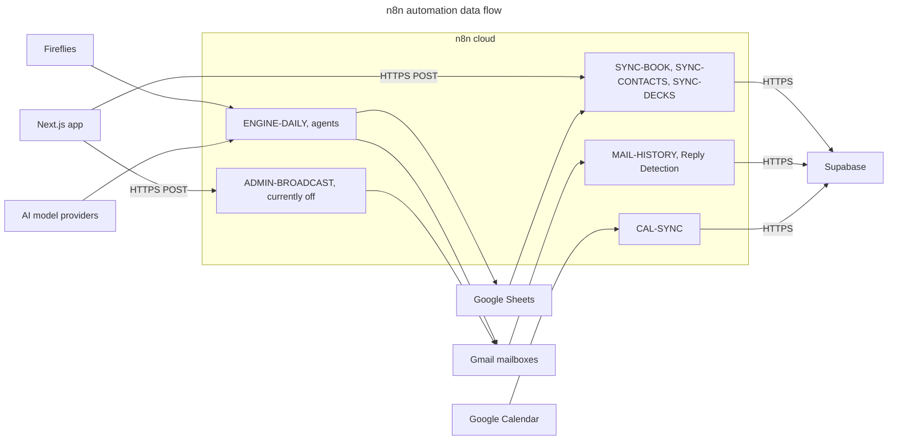

# n8n and integrations

**What n8n is:** a visual automation tool. A workflow is a chain of steps, such as "every hour, read this sheet and update this table".

**Why Sidana uses it:** the deal team's work lives in Gmail, Calendar and Google Sheets. n8n connects them without custom servers.

**Where it runs:** n8n's cloud, not the VPS. No workflow was run for this study.

## How much n8n does

Observed through the n8n API: **163 workflows, 46 active.** Many inactive ones are one-off scripts. Credentials exist for Gmail, Google Calendar, Google Sheets, Fireflies, Supabase and several AI providers (OpenAI, Anthropic, Groq, DeepSeek, NVIDIA). Names were read only, not values.

## Workflows that matter to the portal

| Workflow | ID | Active | Role |
|---|---|---|---|
| `ADMIN-BROADCAST` | `LAXfAiTAFAVb4V5D` | **No** | Sends admin emails to startups |
| `SYNC-CONTACTS` | `oTKgX3jG0Jbt7kzZ` | Yes | Founder emails into `startup_contacts`, hourly and on demand |
| `SYNC-DECKS` | `CURnR40YSaT1H9se` | Yes | Deck links into `startup_decks`, hourly |
| `SYNC-BOOK` | `I8VWdHLb6fxhciqN` | Yes | Startups and investors into Supabase, hourly |
| `CAL-SYNC` | `HgA7X7lgkGBVGLWQ` | Yes | Calendars into meetings |
| `MAIL-HISTORY` | `OiHvfYKKK9mOld2g` | Yes | Mailboxes into `mail_log` |
| `Weekly Founder Update` | `2MG95rlJDoFNz8tJ` | **No** | Weekly reports and emails, Saturdays 10:00 IST |
| `DB-READ` | `zwxXecdM2YFCmbch` | Yes | Fixed read-only queries for agents |
| `MEETINGS-READ` | `Ix9D2oL6zn0Fieoo` | No | Leftover diagnostic helper, safe to review for deletion |

Roles are taken from workflow names and earlier inspection. Only `DB-READ` had its steps inspected in detail.

**The effect of the two inactive workflows:** admin emails to startups fail, and the admin sees the error. No new weekly reports are created, so founders only see existing ones.

## How the app talks to n8n

There's one function: `callN8nWebhook` in [`integrations/n8n/client.ts`](../../src/server/integrations/n8n/client.ts).

| Topic | Detail | Source |
|---|---|---|
| Used by | `sendBroadcast`, `sendTestEmail`, `syncContactsNow` | [`notifications/actions.ts`](../../src/app/admin/notifications/actions.ts) |
| Method | HTTPS POST with JSON | `client.ts` |
| Addresses | `N8N_BROADCAST_WEBHOOK_URL`, `N8N_CONTACTS_SYNC_WEBHOOK_URL` | Environment |
| Authentication | Shared secret `N8N_NOTIFY_SECRET`, added on the server in the JSON body | `client.ts:14`, `client.ts:25` |
| Timeout | 30 seconds by default, 90 seconds for contact sync | `client.ts:11`, `actions.ts:266` |
| Retries | **None**, because repeating a send could email people twice | `client.ts` |
| Errors | Throws a readable error, and the action shows it | `client.ts` |

**Broadcast payload:** `broadcast_id`, `dry`, and `messages`, each with `recipient_id`, `to`, `subject`, `html` and `text`. The email is fully written by the app before n8n receives it.

**Contact sync payload:** empty apart from the secret.

## Admin broadcast flow

**Reading this diagram:** starts at [`composer.tsx:156`](../../src/app/admin/notifications/composer.tsx), with the logic in [`actions.ts:181`](../../src/app/admin/notifications/actions.ts) and [`actions.ts:81`](../../src/app/admin/notifications/actions.ts). The record is written *before* calling n8n, so n8n's status update can't be overwritten by the app. The "n8n updates final status" and "sends through Gmail" steps come from comments in that code and from the workflow's name, because `ADMIN-BROADCAST` wasn't opened for this study. **Today this path takes the failure branch**, because the workflow is off.

## n8n automation flow

**Reading this diagram:** only two arrows start at the app. Everything else runs on n8n's own schedules. Connections come from workflow names and the handoff notes, so individual steps weren't verified one by one. `DB-READ` is confirmed to use a credential named `Supabase service` over HTTPS. For the full picture, open the workflows in n8n.

## Other integrations

| Service | How it's used | In app code? |
|---|---|---|
| **Google Sheets** | The team's working data. Reached **only through n8n** | No Sheets code in the app |
| **Google Drive** | Embedding a deck (`pitch-deck/page.tsx`), logo image in email templates | Links only |
| **Gmail, Calendar, Fireflies** | Through n8n | No |

## Rules

1. **Never trigger a workflow to test it.** Webhooks start real work and can send real email. Tests use [`tests/mock/server.mjs`](../../tests/mock/server.mjs).
2. **Never change sheet values** that already exist. Fill only empty cells, and report conflicts.
3. **`scripts/backfill-weekly-reports.mjs`** has a built-in n8n address and uses `.env.local`, so treat it as live.
