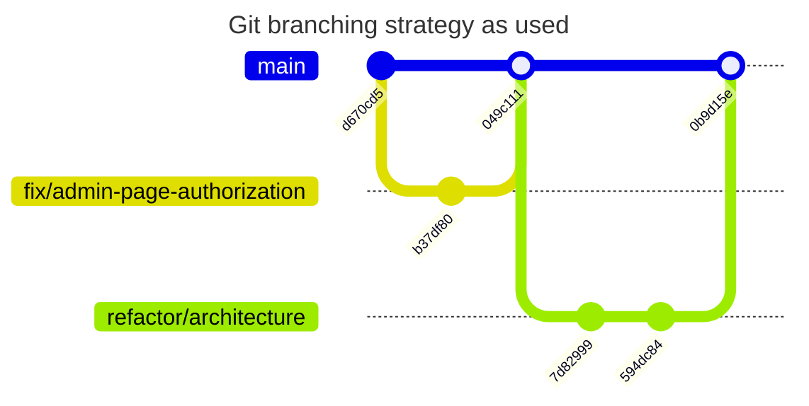
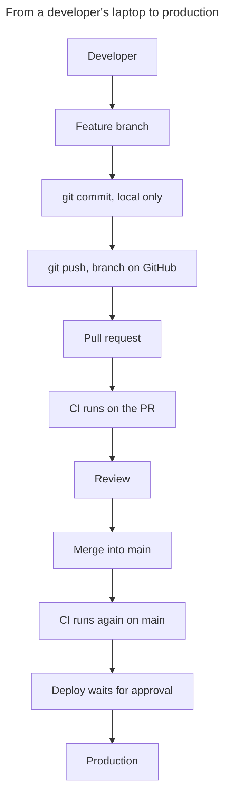

# GitHub and branching

## The repository

| Item | Value | Evidence |
|---|---|---|
| Name and URL | [`abhinav0510/phase-1`](https://github.com/abhinav0510/phase-1) | Observed |
| Visibility | **Public**, so everyone can read the code, history and workflow files | Observed |
| Default branch | `main` | Observed |
| Commits on `main` | 49, of which 13 are merge commits | Observed |
| Tags | None, so releases are identified by commit SHA | Observed |
| Branch protection on `main` | **None**, and no rulesets | Observed |
| Environment | `production`: approval by `abhinav0510`, deploys from `main` only, admins can bypass | Observed |
| Container package visibility | Not verified, because the token lacks package read access | Not verified |

## Local and remote are separate

A branch on your laptop isn't automatically on GitHub, and the reverse is also true. Check each one:

```bash
git branch
```

```bash
git branch -r
```

## Branch inventory

### Remote branches on GitHub

| Branch | Purpose | Merged into `main`? | Status |
|---|---|---|---|
| `main` | Source of production releases | n/a | Active, `0b9d15e` |
| `refactor/architecture` | Folder restructure, safe local dev | Yes, PR 19 | Finished for now |
| `fix/admin-page-authorization` | Admin page access fix | Yes, PR 18 | Finished, can be deleted |
| `chore/production-setup` | Docker, nginx, CI/CD | Yes, PR 10 | Finished, can be deleted |
| `chore/dependabot-minor-patch` | Limit Dependabot to minor and patch | **No**, PR 17 open | Waiting |
| `feat/portal-updates-and-tests` | Theme, financials, logos, tests | Yes, PR 9 | Finished, can be deleted |
| `feat/weekly-quiet-weeks` | Weekly report backfill | Yes, PR 6 | Finished, can be deleted |
| `feat/pitch-deck` | Pitch deck page | Yes, PR 5 | Finished, can be deleted |
| `feat/founder-dashboard-v2` | Dashboard redesign | Yes, PR 4 | Finished, but see the local note below |
| `feat/homepage-v3` | Homepage and sign-in pages | Yes, PRs 2 and 3 | Finished, can be deleted |
| `dependabot/npm_and_yarn/next-16.4.3` | Major update | No, PR 14 open | Hold |
| `dependabot/npm_and_yarn/typescript-7.0.2` | Major update | No, PR 16 open | Hold |
| `dependabot/npm_and_yarn/types/node-26.6.5` | Major update | No, PR 15 open | Hold |
| `dependabot/npm_and_yarn/lucide-react-1.62.0` | Major update | No, PR 13 open | Hold |
| `dependabot/npm_and_yarn/minor-and-patch-0c333dac8c` | Six smaller updates | No, PR 12 open | Review |
| `dependabot/docker/node-26.11-bookworm-slim` | Node image update | No, PR 11 open | Hold |

### Local branches on the machine used for this study

| Branch | Tracks | State |
|---|---|---|
| `refactor/architecture` (checked out) | `origin/refactor/architecture` | Up to date with its remote, one merge commit behind `main` |
| `main` | `origin/main` | **15 commits behind**, so run `git pull` before using it |
| `feat/founder-dashboard-v2` | Its remote | **One commit not on GitHub** (`5c9c45f`), so check it before deleting |
| `chore/dependabot-minor-patch`, `chore/production-setup`, `feat/pitch-deck`, `feat/portal-updates-and-tests`, `feat/weekly-quiet-weeks`, `fix/admin-page-authorization` | Their remotes | Same as their remotes |

### Local-only and deleted names
`feat/profile-completion` (PRs 7 and 8) and `vercel/react-server-components-cve-vu-rfi3f6` (PR 1) were merged, and those branches no longer appear on GitHub.

## The branching strategy in practice

| Prefix | Use for | Example |
|---|---|---|
| `feat/` | A new feature | `feat/pitch-deck` |
| `fix/` | A bug fix | `fix/admin-page-authorization` |
| `chore/` | Setup and tooling | `chore/production-setup` |
| `refactor/` | Restructuring without behaviour change | `refactor/architecture` |
| `dependabot/` | Created automatically | Dependency updates |

This is GitHub Flow: short-lived branches from `main`, merged by pull request. There's no separate staging branch.



**Reading this diagram:** each piece of work starts from `main`, gets commits on its own branch, then merges back by pull request. These are real commits. Each merge to `main` runs CI, which then starts a release that waits for approval.

## Development workflow



**Reading this diagram:** nothing reaches production until the last step. Code review is expected, but with no branch protection it isn't enforced. CodeRabbit is installed on the repo, but it skips automatic reviews on this repository.

| Stage | Where the code is | Who can see it | Is it live? |
|---|---|---|---|
| Local commit | Your laptop | You | No |
| Remote branch | GitHub | Anyone, because the repo is public | No |
| Pull request | GitHub, proposed for `main` | Anyone | No, though Vercel may build a preview |
| Merged to `main` | GitHub's `main` | Anyone | **Not yet, needs approval** |
| Deployed | Production server | Users | **Yes** |

## Git commands

| Command | What it does | Example |
|---|---|---|
| `git status` | Shows changed files and your branch | `git status` |
| `git branch` | Lists local branches | `git branch -a` lists remote ones too |
| `git switch` | Moves to a branch | `git switch -c feat/my-work origin/main` creates one |
| `git checkout` | Older command for switching, also restores files, so be careful | `git checkout main` |
| `git add` | Chooses files for the next commit | `git add src/app/login/page.tsx` |
| `git commit` | Saves a snapshot locally | `git commit -m "Fix login message"` |
| `git push` | Sends commits to GitHub | `git push -u origin feat/my-work` |
| `git fetch` | Downloads GitHub's state without changing your files | `git fetch origin` |
| `git pull` | Fetches, then merges into your branch | `git pull` |
| `git merge` | Combines another branch into yours | `git merge origin/main` |
| `git log` | Shows history | `git log --oneline -10` |
| `git diff` | Shows changes | `git diff origin/main...HEAD` |

**A typical change:**

```bash
git fetch origin
```

```bash
git switch -c feat/my-change origin/main
```

```bash
npm run test:unit
```

```bash
git add src/app/login/page.tsx
```

```bash
git commit -m "Clarify the sign-in error message"
```

```bash
git push -u origin feat/my-change
```

Then open a pull request on GitHub.

## What git must never contain

[`.gitignore`](../../.gitignore) keeps out `.env`, `.env.local`, `/deploy/app.env`, `/deploy/.env`, `/deploy/backup.env`, `*.pem`, `*.key` and `*.local.csv`. The Secret scan job also checks history on every run. A committed secret should be treated as leaked and replaced, even after removing it, because history stays public.

**Left uncommitted on purpose:** `PROJECT-HANDOFF.md`, `docs/deck-and-memo-storage-plan.md`, `docs/architecture/AUDIT-AND-MIGRATION-PLAN.md` and this handbook.
