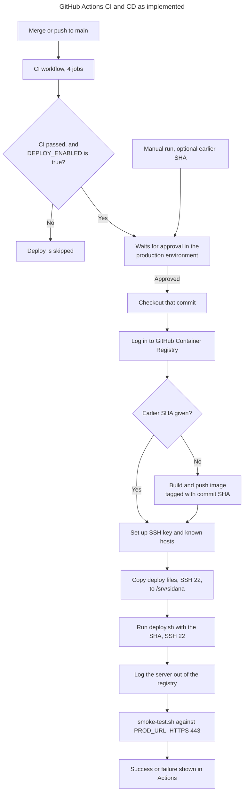

# GitHub Actions and CI/CD

**CI (Continuous Integration)** tests every change automatically. **CD (Continuous Deployment)** ships a tested change to production.

**GitHub Actions** runs these on GitHub's temporary machines, called runners. All jobs here use `ubuntu-24.04`, and each runner is thrown away afterwards.

## Workflows

| Workflow | File | Runs when |
|---|---|---|
| CI | [`ci.yml`](../../.github/workflows/ci.yml) | On any pull request and on a push to `main` |
| Deploy | [`deploy.yml`](../../.github/workflows/deploy.yml) | After CI finishes on `main`, or when started by hand |
| Dependabot Updates | GitHub-managed, set by [`dependabot.yml`](../../.github/dependabot.yml) | Weekly for npm, monthly for actions and Docker |

**Pushing a branch without a pull request runs no CI.** `ci.yml:3-6` only lists pull requests and `main`.

## CI jobs

A newer run on the same branch cancels the older one (`ci.yml:8-10`). All four jobs run at the same time.

| Job | Lines | What it does |
|---|---|---|
| **Lint, types, unit tests, audit** | `ci.yml:16-34` | `npm ci`, `lint`, `typecheck`, `test:unit`, checks server scripts are executable, fails on high-severity advisories |
| **Secret scan** | `ci.yml:36-46` | gitleaks over the full history |
| **Browser tests** | `ci.yml:48-69` | Installs Chrome, runs all browser tests on the standalone server. Saves results if it fails |
| **Production image behind nginx** | `ci.yml:71-162` | See below |

### The production stack job

This job runs the real image behind real nginx on the runner, using fake Supabase and n8n:

1. Builds the image (`ci.yml:87-92`).
2. Confirms there are no secret files in it (`:93-96`).
3. Confirms the app refuses to start without its settings (`:97-101`).
4. Starts in HTTP mode and runs the smoke test (`:114-117`).
5. Confirms a non-root user and read-only disk (`:118-122`).
6. Confirms unknown hosts are dropped (`:123-127`).
7. Confirms sign-in rate limiting (`:128-133`).
8. Switches to HTTPS with a test certificate and runs the smoke test again (`:134-145`).
9. Confirms the HTTP redirect and HSTS (`:146-149`).
10. Signs in and saves through nginx in a real browser (`:150-153`).

It uses ports 8080 and 8443 on the runner, so these aren't production ports.

## Deploy workflow

**Reading this diagram:**
- **Trigger:** `workflow_run` means Deploy starts after CI (`deploy.yml:7-10`). The job only runs if CI succeeded on a push, or when someone starts it by hand (`:29-32`).
- **Approval:** the `production` environment holds the run until `abhinav0510` approves it (`:35-37`).
- **Tests aren't repeated:** Deploy relies on CI having passed. A manual run skips that requirement.
- **Image:** only built when no SHA is given (`:50-64`).
- **On the server:** see [deployment and rollback](15-DEPLOYMENT-AND-ROLLBACK.md).
- **Smoke test failure:** this marks the run failed, but it does **not** roll back, because the release has already finished.

## Secrets and variables (names only)

| Name | Type | Scope | Used for |
|---|---|---|---|
| `VPS_HOST`, `VPS_USER` | Secret | `production` | Where to connect |
| `VPS_SSH_KEY` | Secret | `production` | Dedicated deploy key |
| `VPS_KNOWN_HOSTS` | Secret | `production` | Confirms it's the right server |
| `GITHUB_TOKEN` | Automatic | Each run | Registry login, gitleaks |
| `NEXT_PUBLIC_SUPABASE_URL`, `NEXT_PUBLIC_SUPABASE_ANON_KEY` | Variable | `production` | Built into the image, public by design |
| `DEPLOY_ENABLED` | Variable | Repository | Master switch, currently `true` |
| `PROD_URL` | Variable | Repository | Address the smoke test checks |
| `VPS_PORT` | Optional variable | Not set | Defaults to 22 |

Workflows read these as `${{ secrets.NAME }}` or `${{ vars.NAME }}`. GitHub hides secret values in logs, which is why a step name appears as "Copy the \*\*\* files": the word matches `VPS_USER`.

**Permissions:** CI only reads code (`ci.yml:12-13`). Deploy can also publish packages (`deploy.yml:22-24`). Pull requests from forks can't read these secrets.

## Artifacts

| Name | Made when | Kept |
|---|---|---|
| `browser-test-results` | Browser job fails | 7 days |
| `stack-test-results` | Stack job fails | 7 days |
| Docker image, `ghcr.io/abhinav0510/phase-1:<sha>` | Each release | In the registry; on the server for about 14 days |

## Failure handling

| What fails | What happens |
|---|---|
| Any CI job | Deploy is skipped; red check on the PR or commit |
| Approval rejected or ignored | Nothing is released |
| Image build | Run fails; the server isn't touched |
| `deploy.sh` health check | Automatic rollback, then the run fails |
| Live check | Run fails, and the release stays in place |

## Security notes

- **Actions use version tags, not exact SHAs,** and SHA pinning isn't required (Observed). Dependabot updates them monthly.
- **`main` has no branch protection**, so a direct push would also start CI and a release. The approval step remains.
- **Admins can bypass the approval** (Observed).
