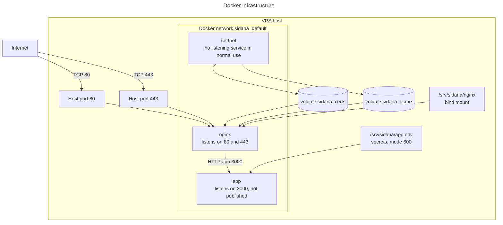

# Docker architecture

**What Docker is:** a way to package an app with everything it needs, so it runs the same anywhere.

**Why Sidana uses it instead of running directly on the VPS:**
- The exact Node version travels with the app.
- A release swaps one image for another, so going back is quick.
- Each part is isolated, with limits on memory and permissions.
- CI tests the same image type that production runs.

## The image: [`Dockerfile`](../../Dockerfile)

This is a multi-stage build: earlier stages do the heavy work, and only the results are copied into the final image.

| Stage | Lines | Base | Does |
|---|---|---|---|
| `deps` | 3-6 | `node:24.22-bookworm-slim` | `npm ci` |
| `build` | 8-18 | Same | `next build` with `NEXT_OUTPUT=standalone` |
| `run` | 20-38 | Same | Copies only the built server, static files and `public` |

| Setting | Value | Line |
|---|---|---|
| Build arguments | `NEXT_PUBLIC_SUPABASE_URL`, `NEXT_PUBLIC_SUPABASE_ANON_KEY`, `APP_VERSION` | 10, 11, 22 |
| Listening port | `PORT=3000` | 26 |
| Documented port | `EXPOSE 3000` | 35 |
| User | `app`, UID 1001, not root | 34 |
| Health check | Every 15 seconds, calls `/api/health` | 36-37 |
| Start command | `node server.js` | 38 |

[`.dockerignore`](../../.dockerignore) keeps secrets, tests and docs out of the image. Server secrets are provided at run time from `app.env`, not at build time.

## The containers: [`docker-compose.yml`](../../deploy/docker-compose.yml)

Docker Compose describes all the containers together.

| | `app` | `nginx` | `certbot` |
|---|---|---|---|
| Image | `ghcr.io/abhinav0510/phase-1:<sha>` | `nginx:1.30-alpine` | `certbot/certbot:v5.9.0` |
| Restart policy | `unless-stopped` | `unless-stopped` | `unless-stopped` |
| Published ports | None; `expose: 3000` | 80, 443 | None |
| Health check | From the image | `/nginx-health` | None |
| Read-only disk | Yes | No | No |
| Memory limit | 1 GB, heap 700 MB | None | None |
| Linux capabilities | All dropped | Default | Default |
| Starts | Always | After `app` is healthy | When the `tls` profile is on |

**Temporary memory disks for `app`:** `/tmp` (64 MB) and `/app/.next/cache` (256 MB). The data cache therefore starts empty at each deploy.

### Volumes and bind mounts

| Name | Type | Used by | Holds |
|---|---|---|---|
| `sidana_certs` | Volume | `nginx` read-only, `certbot` | HTTPS certificates |
| `sidana_acme` | Volume | `nginx` read-only, `certbot` | Let's Encrypt check files |
| Unnamed volume | Volume | `certbot` | `/var/lib/letsencrypt`, from the image (Observed) |
| `./nginx/...` | Bind mount | `nginx`, read-only | nginx config from `/srv/sidana/nginx` |

**Network:** `sidana_default`, a bridge network that Compose creates. Containers reach each other by name, so nginx finds the app at `app:3000`.



**Reading this diagram:**
- **Published ports:** only nginx's 80 and 443 connect to the host. The app's port 3000 stays on the private network.
- **Certificates:** certbot writes them to a shared volume, and nginx reads them.
- **Settings:** secrets come from `app.env` when the container starts.

## How nginx picks HTTP or HTTPS

[`05-select-site.sh`](../../deploy/nginx/05-select-site.sh) runs when nginx starts. If a certificate exists it uses the HTTPS template, otherwise HTTP. This is how a new server can start and pass the certificate check. It also reloads nginx every 6 hours to pick up renewed certificates.

## Commands used by the scripts

Run from `/srv/sidana`. `dc.sh` is a wrapper that adds the settings files.

| Command | Used in | Effect |
|---|---|---|
| `./scripts/dc.sh pull app` | `deploy.sh:32` | Downloads the new image |
| `./scripts/dc.sh up -d --wait --wait-timeout 120 app` | `deploy.sh:38` | Starts the new app, waits for healthy |
| `./scripts/dc.sh run --rm --no-deps nginx nginx -t` | `deploy.sh:44` | Tests nginx config |
| `./scripts/dc.sh up -d --force-recreate --no-deps nginx` | `deploy.sh:45` | Restarts nginx with new config |
| `docker image prune -af --filter "until=336h"` | `deploy.sh:51` | Removes images over 14 days old that aren't in use |

**Safe, read-only commands:**

```bash
./scripts/dc.sh ps
```

```bash
./scripts/dc.sh logs --tail 100 app
```

```bash
docker stats --no-stream
```

**Don't run `down`, `rm` or `docker system prune`** on production unless you're following an agreed procedure.

## Why only one app container?

Next.js keeps its data cache and cache-clearing inside one process. A second container wouldn't see a founder's save clearing the cache, so it could serve out-of-date data until a shared cache is added.
