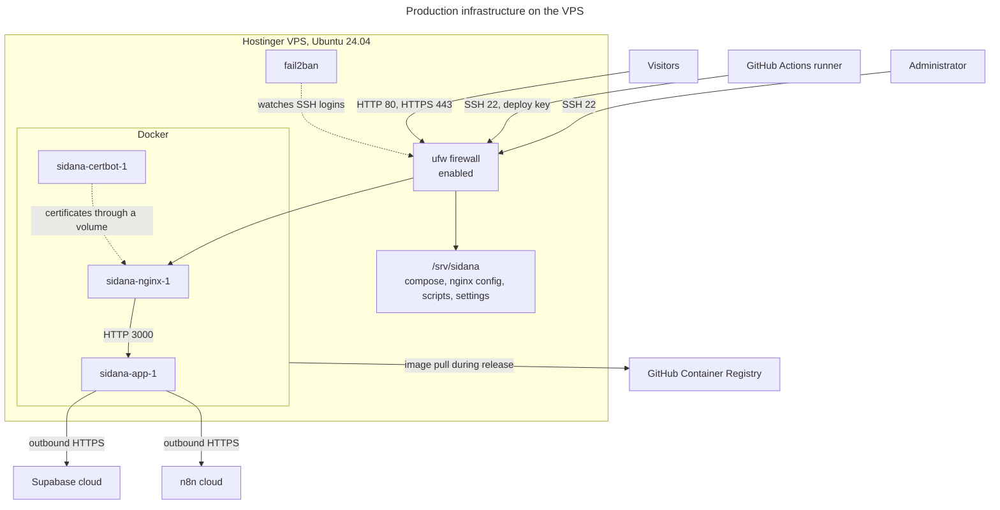

# Hostinger VPS infrastructure

Inspected on 31 October 2026 with read-only commands over SSH as the `deploy` user, which has no sudo. Nothing was changed or restarted.

## Concepts

| Term | Plain meaning | Here |
|---|---|---|
| **VPS** | A rented virtual computer that's always on | The Hostinger server |
| **Docker** | Runs apps in isolated boxes | Installed on the VPS |
| **Image** | A frozen, ready-to-run package | `ghcr.io/abhinav0510/phase-1:<sha>` |
| **Container** | A running copy of an image | `sidana-app-1` |
| **Docker network** | A private network between containers | `sidana_default` |
| **Volume** | Storage that survives a container being replaced | `sidana_certs` |
| **Web server** | Software that answers HTTP requests | nginx and the Next.js server both do |
| **Reverse proxy** | A server that receives requests and passes them on | nginx, in front of Next.js |

## The server

| Item | Value | Evidence |
|---|---|---|
| Provider | Hostinger | Observed: registrar and hPanel screenshot |
| Plan | KVM 2 | Observed: hPanel screenshot from the owner |
| Operating system | Ubuntu 24.04.5 LTS, x86_64 | Observed |
| CPU | 2 vCPUs | Observed |
| Memory | 7.8 GB, plus 2 GB swap | Observed |
| Disk | 96 GB, 5% used | Observed |
| Docker | 29.9.2 | Observed |
| Docker Compose | 5.6.1 | Observed |
| nginx | 1.30.6 | Observed |
| Account ownership | A separate Hostinger account, so this project's connector can't see the VPS | Observed |

The IP address is deliberately left out. Find it in hPanel or ask an administrator.

## Running containers

| Container | Version | Status when inspected | Memory used |
|---|---|---|---|
| `sidana-app-1` | `0b9d15e` | Healthy | 88 MB of 1 GB |
| `sidana-nginx-1` | `nginx:1.30-alpine` | Healthy | 8 MB |
| `sidana-certbot-1` | `certbot/certbot:v5.9.0` | Running, with no health check | 2 MB |

Earlier images, `049c111` and `d670cd5`, were still on the server, ready for a rollback.

## Production infrastructure



**Reading this diagram:**
- **The VPS's role:** it runs the web app and stores no portal data, so it can be rebuilt without data loss.
- **Inbound:** public traffic and SSH arrive through the firewall. Docker publishes 80 and 443, and Docker-published ports can bypass ufw's normal rules, so don't rely on ufw alone to hide a published port.
- **Outbound:** the app calls Supabase and n8n, which live elsewhere.

## The deployment directory: `/srv/sidana`

Owned by `deploy`.

| Path | Purpose | Source |
|---|---|---|
| `docker-compose.yml`, `nginx/`, `scripts/`, `README.md` | Copied in at each release | [`deploy/`](../../deploy) |
| `.env` | Settings for Compose, mode 600 | Created by hand |
| `app.env` | App secrets, mode 600 | Created by hand |
| `release.env` | The running version, `APP_TAG` | Written by `deploy.sh` |
| `.nginx-hash` | Detects nginx config changes | Written by `deploy.sh` |

**`.env` names:** `APP_IMAGE`, `DOMAIN`, `LETSENCRYPT_EMAIL`, `COMPOSE_PROFILES`, `APP_MEMORY`, `APP_HEAP_MB`.

**`app.env` names:** `NEXT_PUBLIC_SUPABASE_URL`, `NEXT_PUBLIC_SUPABASE_ANON_KEY`, `SUPABASE_SERVICE_ROLE_KEY`, `N8N_NOTIFY_SECRET`, `N8N_BROADCAST_WEBHOOK_URL`, `N8N_CONTACTS_SYNC_WEBHOOK_URL`.

## Protections

| Item | State | Evidence |
|---|---|---|
| ufw firewall | Enabled. The setup script opens 22, 80 and 443 | Enabled: Observed. Rules: **Not verified**, needs root |
| fail2ban | Active | Observed |
| Automatic security updates | Active | Observed |
| Malware scanner | Hostinger's panel shows it active, and a `monarx` cron file exists | Observed |
| SSH password login | Left on by the setup script, deliberately | **Not verified**, needs root to read the config |
| `deploy` user | No sudo. In the `docker` group, which is **effectively root** | Observed |

## Backups

| Item | State |
|---|---|
| Hostinger snapshots and backups | The panel showed 2 entries. Dates and schedule: **needs admin** |
| Database backup script | [`backup-db.sh`](../../deploy/scripts/backup-db.sh) exists, but **isn't running**: no `backup.env`, no `backups` folder contents, no crontab for `deploy` |
| Supabase's own backups | Depends on the plan: **needs admin** |
| Founder logos (Supabase Storage) | Not covered by the script |
| Restore test | Never done |

## How the server was set up

[`bootstrap-vps.sh`](../../deploy/scripts/bootstrap-vps.sh), run once as root, installed Docker, ufw, fail2ban and automatic updates, added swap, and created `deploy` and `/srv/sidana`. [`init-tls.sh`](../../deploy/scripts/init-tls.sh) got the first certificate.

## Connecting

Administrators connect with SSH keys. Ask an administrator to add your key rather than sharing passwords.

```bash
ssh deploy@<server-address>
```

```bash
cd /srv/sidana && ./scripts/dc.sh ps
```
