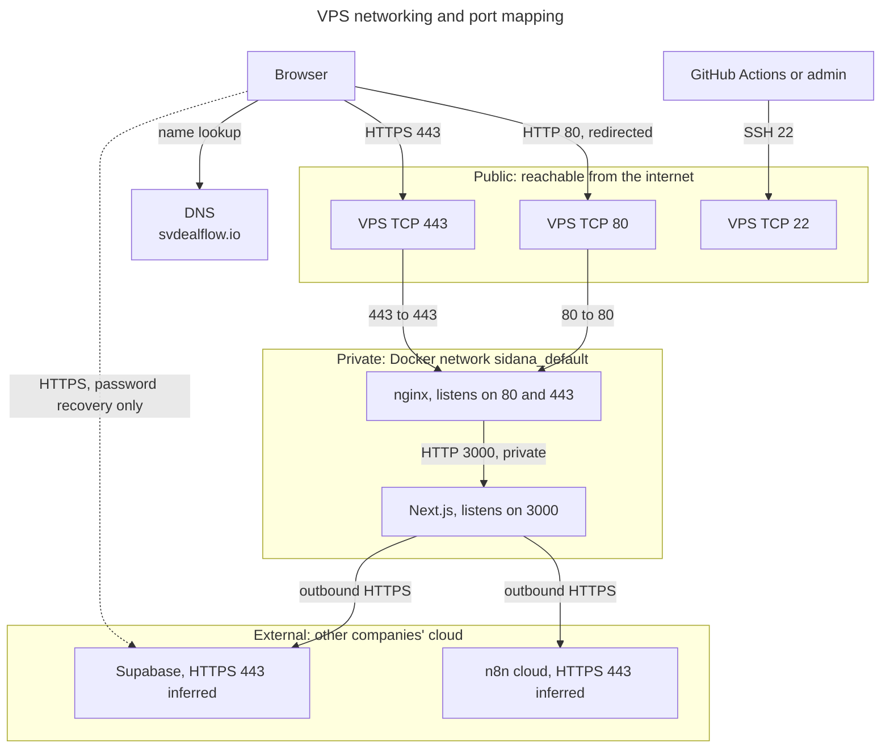

# Networking and ports

**What a port is:** an IP address finds the machine, and a port finds the program on it, like a building address and an apartment number.

## Six kinds of port

| Kind | Meaning | Example here |
|---|---|---|
| Application listening port | The port a program opens | Next.js on 3000 |
| Docker container port | That port, inside the container | `3000/tcp` on `sidana-app-1` |
| Host-published port | A host port forwarded into a container | Host 443 → nginx 443 |
| Public internet port | What outsiders can reach | 22, 80, 443 |
| Reverse-proxy upstream port | Where the proxy forwards to | nginx → `app:3000` |
| External service port | A port on someone else's service | Supabase over HTTPS |

**Example of port mapping:** `"443:443"` in Compose means "traffic reaching the VPS on 443 goes to port 443 in the nginx container". The app has no such line, so nothing outside Docker can reach it directly.

## Production port inventory

Checked from outside on 31 October: 22, 80 and 443 answered; 3000, 4329 and 5432 didn't.

| Service | Internal port | Host port | Public | Purpose | Source |
|---|---:|---:|---|---|---|
| nginx, HTTP | 80 | 80 | **Yes** | Redirects to HTTPS, certificate checks | `docker-compose.yml:45`, `docker ps` |
| nginx, HTTPS | 443 | 443 | **Yes** | Main public entrance | `docker-compose.yml:46`, `docker ps` |
| Next.js | 3000 | None | **No**, Docker network only | The application | `Dockerfile:26`, `docker-compose.yml:21` |
| certbot | No service in normal use | None | No | The image lists 80 and 443, but they aren't published | `docker ps` |
| SSH | 22 | 22 | **Yes** | Admin and release access | `ss`, outside check |
| Docker DNS | 53, on `127.0.0.11` | None | No | Lets nginx find `app` by name | `nginx.conf:37` |
| System DNS | 53, on `127.0.0.53` and `.54` | Loopback | No | The server's own name lookups | `ss` |
| Unidentified local service | 65529 | Loopback, `127.0.0.1` | No | Probably the Monarx malware agent (Inferred) | `ss` |

## External services

| Service | Port | Public | Evidence |
|---|---|---|---|
| Supabase REST, Auth, Storage | 443 | Run by Supabase | **Inferred**: `https://` URL with no port set |
| Supabase PostgreSQL | Not verified | Unknown | The app doesn't connect directly. Only the backup script would, and that isn't configured |
| n8n cloud webhooks | 443 | Run by n8n | **Inferred**: `https://` address |
| GitHub Container Registry | 443 | Run by GitHub | **Inferred** |
| Let's Encrypt | Connects inbound to port 80 | Run by Let's Encrypt | Config: webroot method |

PostgreSQL's usual port isn't open on this VPS, because the database doesn't run here. n8n doesn't run here either.

## Development and test ports

None of these exist in production.

| Service | Port | Where | Source |
|---|---:|---|---|
| Next.js, `npm run dev` | 3000 | Your Mac | [`scripts/dev.mjs`](../../scripts/dev.mjs) |
| Fake Supabase and n8n, `npm run dev` | 4330 | Your Mac | `scripts/dev.mjs` |
| Next.js, browser tests | 3100 | Mac or CI runner | [`playwright.config.ts`](../../playwright.config.ts) |
| Fake Supabase and n8n, browser tests | 4329 | Mac or CI runner | `playwright.config.ts` |
| nginx, stack test | 8080, 8443 | CI runner | `ci.yml:79-80` |

## Network map

**Reading this diagram:**
- **Public:** the only three doors from the internet.
- **Private:** traffic between nginx and the app isn't encrypted, because it never leaves the server.
- **External:** these are outbound connections that the app starts. No Supabase or n8n port is opened on the VPS.
- **Dotted line:** three password screens connect from the browser to Supabase directly, which is why the Content Security Policy allows the Supabase address.

## How nginx routes a request

| Request | Result | Source |
|---|---|---|
| Port 80, known host | 301 to `https://svdealflow.io` | `https.conf.template:16` |
| Port 80, `/.well-known/acme-challenge/` | Serves the certificate check file | `internal.conf:9` |
| Port 80 or 443, unknown host or bare IP | Dropped | `https.conf.template:7`, `:21` |
| `https://www.svdealflow.io` | 301 to `https://svdealflow.io` | `https.conf.template:38` |
| `/_next/static/` | Passed to the app, cached by nginx | `app.conf:13` |
| `/login`, `/teamonly` | Passed to the app, with the sign-in rate limit on POST | `app.conf:25` |
| Dotfile paths | 404 | `app.conf:20` |
| Everything else | Passed to the app, general rate limit | `app.conf:31` |
| App unreachable | "Back in a moment" page, status 503 | `app.conf` |

**Limits** (`nginx.conf`): 10 sign-in POSTs a minute per IP with a burst of 10, 30 requests a second per IP with a burst of 100, 100 connections per IP and a 4 MB upload size.

**Addresses:** nginx passes the real host and protocol to the app through `X-Forwarded-Host` and `X-Forwarded-Proto` ([`proxy.conf`](../../deploy/nginx/snippets/proxy.conf)). Server Actions and redirects rely on these, so they mustn't be removed.
