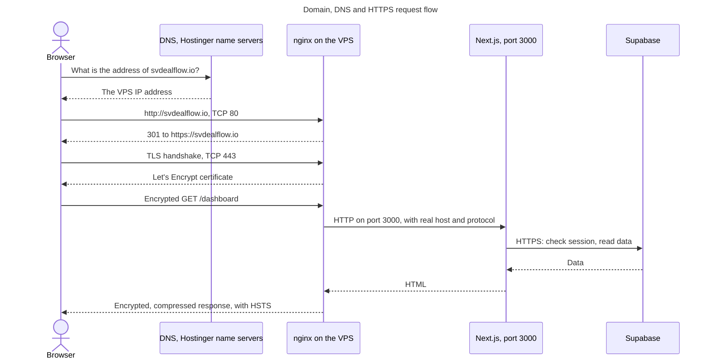

# Domain, DNS and SSL

## Concepts

| Term | Plain meaning |
|---|---|
| **DNS** | The internet's phone book. It turns `svdealflow.io` into an IP address |
| **A record** | "This name points to this IPv4 address" |
| **CNAME** | "This name is an alias of that name" |
| **TTL** | How long others may remember an answer |
| **SSL/TLS** | Encryption between the browser and the server. TLS is the modern name |
| **Certificate** | A signed file proving the server controls the domain |
| **HTTPS** | HTTP over TLS |

**Why HTTPS is required:** without it, passwords and session cookies travel in readable form, and browsers mark the site as not secure.

## What's configured

| Item | Value | Evidence |
|---|---|---|
| Domain | `svdealflow.io` | Observed |
| Registrar | Hostinger | Observed: `whois` |
| Name servers | `nova.dns-parking.com`, `cosmos.dns-parking.com`, Hostinger's | Observed |
| Root `A` record | One record, pointing at the VPS | Observed |
| `www` | CNAME to `svdealflow.io` | Observed |
| IPv6 `AAAA`, `CAA`, `MX` | None | Observed |
| TTL | Not verified | Not verified |

With no `MX` records, this domain doesn't receive email. Team email uses `sidanaventures.com`, which is separate. `sidanalab.vercel.app`, the older Vercel address, still responds, and it isn't part of this domain.

## Certificate

| Item | Value | Evidence |
|---|---|---|
| Provider | Let's Encrypt | Observed |
| Covers | `svdealflow.io`, `www.svdealflow.io` | Observed: issued that way |
| Expires | 28 January 2027 | Observed |
| Protocol seen | TLS 1.3 | Observed |
| Allowed | TLS 1.2 and 1.3 | Config: `https.conf.template` |
| HSTS | `max-age=31536000`, one year | Observed |

## Renewal

1. The `certbot` container tries `certbot renew` every 12 hours (`docker-compose.yml:67`).
2. Let's Encrypt checks a file served through `/.well-known/acme-challenge/` on port 80, called the webroot method.
3. A background loop reloads nginx every 6 hours, which picks up a renewed certificate.

A rehearsal (`certbot renew --dry-run`) succeeded on 30 October. **Port 80 must stay open** for renewals. Nothing alerts anyone if renewal starts failing, so check expiry occasionally:

```bash
./scripts/dc.sh exec -T certbot certbot certificates
```

## A request from start to finish



**Reading this diagram:**
- **DNS:** happens first, and browsers remember the answer.
- **Redirect:** only the first visit needs it. After that, HSTS makes the browser go straight to HTTPS.
- **TLS ends at nginx:** the next hop stays inside the server's private Docker network.
- **`www` and unknown names:** `www` redirects to the main address, and any other name or bare IP is dropped. Port 80 returns no response, and port 443 refuses the handshake.

## nginx server blocks

| Listens on | Name | Does | Source |
|---|---|---|---|
| 80 | Default | Answers `/nginx-health` and certificate checks, otherwise drops | `https.conf.template:3-7` |
| 80 | `svdealflow.io`, `www` | Certificate checks, otherwise 301 to HTTPS | `:12-16` |
| 443 | Default | Refuses the TLS handshake | `:21-23` |
| 443 | `www.svdealflow.io` | 301 to the main address | `:34-38` |
| 443 | `svdealflow.io` | The real site | `:42-44` |

`http.conf.template` is used instead before a certificate exists.

## Before changing the domain

Never change these without a plan:
1. Add the new address to Supabase's Site URL and Redirect URLs, or password resets break. Whether this has been done for `svdealflow.io` is **not verified**.
2. Check n8n emails for links to old addresses. **Not verified.**
3. Update `DOMAIN` on the server and `PROD_URL` on GitHub, then request a new certificate.
4. Update the DNS records.

HSTS means browsers that have visited will refuse plain HTTP for a year, so don't turn HTTPS off.
