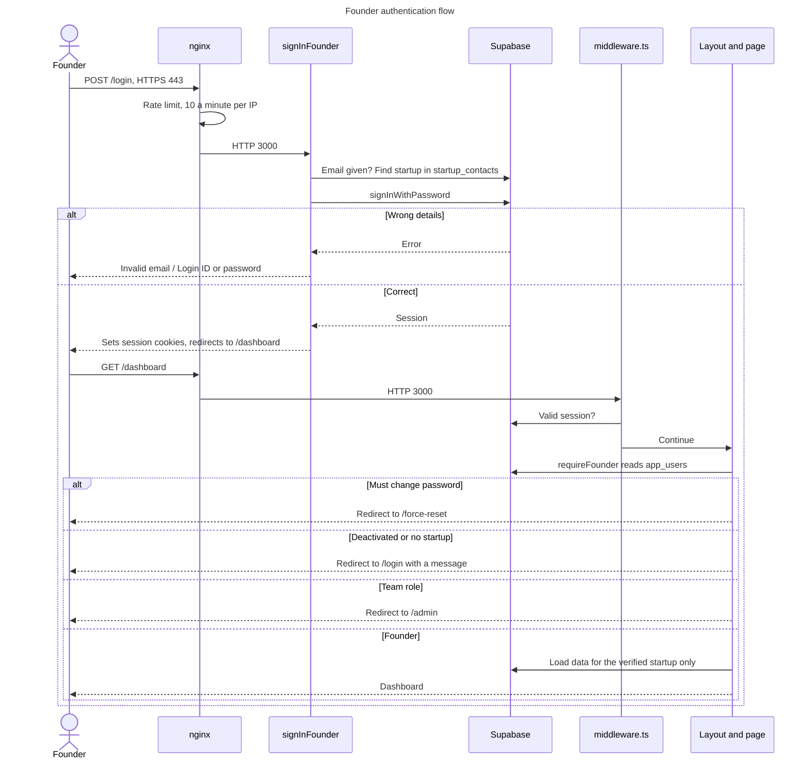

# Authentication and security

**Authentication** asks who you are. **Authorization** asks what you may do.

## Who signs in, and how

| User | Page | Signs in with | Action |
|---|---|---|---|
| Founder | `/login` | Email on file, or Login ID, plus password | `signInFounder` |
| Team | `/teamonly`, unlisted | Email and password | `signInTeam` |

Each startup has one Supabase login with an internal address, built by `founderEmailForStartup` in [`provisioning.ts`](../../src/server/auth/provisioning.ts). Any email in `startup_contacts` for that startup can sign in with the shared password. The same error appears for an unknown email and a wrong password, so the form can't reveal who has an account.

**Roles** ([`db.ts`](../../src/shared/types/db.ts)):

| Group | Roles | Lands on |
|---|---|---|
| Admin | `owner`, `ops`, `deals_desk`, `angel_desk` | `/admin` |
| Founder | `founder` | `/dashboard` |
| Other | `investor` | No investor portal; admin pages are refused |

## Sign-in and page access

**Reading this diagram:** `signInFounder` is at [`login/actions.ts:60`](../../src/app/login/actions.ts), and `requireFounder` is in [`session.ts`](../../src/server/auth/session.ts). A sign-in only proves identity. Every page then decides access for itself.

## Where each check happens

| Layer | File | Enforces | Limit |
|---|---|---|---|
| nginx | [`nginx.conf`](../../deploy/nginx/nginx.conf) | HTTPS, rate limits, known hosts | Doesn't know who you are |
| Middleware | [`middleware.ts`](../../src/middleware.ts) | Signed-in or not | Doesn't check roles |
| Layouts | `admin/layout.tsx`, `(founder)/layout.tsx` | Role, for the layout itself | **Doesn't protect the page's data** |
| Pages | Every admin and founder `page.tsx` | Role, before loading data | Must be remembered per page |
| Server Actions | `actions.ts` files | Role or session | Must be remembered per action |
| Data queries | [`data/founder.ts`](../../src/server/data/founder.ts) | Scope by verified `startupId` | Relies on callers |
| Service layer | Not built yet | Planned central authorization | n/a |
| Database RLS | Supabase | Limits the anon key and user tokens | Bypassed by the service-role key. Live rules **not verified** |

**The lesson behind page-level checks:** in Next.js, a page and its layout render together, so a redirect in the layout doesn't stop the page's data being sent. This caused a real bug, fixed in pull request 18. Two tests now guard against it:
- [`08-admin-authorization.spec.ts`](../../tests/e2e/08-admin-authorization.spec.ts) reads raw response bodies.
- [`page-guards.test.ts`](../../tests/unit/page-guards.test.ts) requires the check first on every page.

**When you add a page:** make `await requireAdmin()` or `await requireFounder()` its first step, and add it to the browser test list.

## Passwords

| Flow | How it works | Code |
|---|---|---|
| Forgot password | Browser asks Supabase to email a link | `forgot-password/page.tsx` |
| Reset password | Browser sets a new one, using the link's session | `reset-password/page.tsx` |
| Change password | Browser, while signed in | `settings/change-password.tsx` |
| Forced change | `must_reset` flag sends the user to `/force-reset`. Cleared on the server after a real change | [`force-reset/actions.ts`](../../src/app/force-reset/actions.ts) |
| Admin reset | `resetUserPassword` | `admin/users/actions.ts` |

Users can't clear `must_reset` themselves, because it's stored in `app_metadata`.

## Sessions

Supabase issues the session, stored in cookies by `@supabase/ssr`. Middleware refreshes it on each request. Sign-out uses `POST /auth/signout`.

## Protections

| Protection | Detail | Source |
|---|---|---|
| HTTPS and HSTS | 1 year | `https.conf.template` |
| Security headers | CSP, `X-Frame-Options: DENY`, `nosniff`, referrer and permissions policies | [`next.config.mjs`](../../next.config.mjs) |
| Rate limiting | Per IP, by nginx | `nginx.conf` |
| Faked headers | `X-Forwarded-For` is overwritten, and the internal `x-middleware-subrequest` is cleared | [`proxy.conf`](../../deploy/nginx/snippets/proxy.conf) |
| Server code stays on the server | `import "server-only"`, enforced by a test | [`architecture-boundaries.test.ts`](../../tests/unit/architecture-boundaries.test.ts) |
| Investor contacts | Founder reads select safe columns only, and reply text has contact details removed | `data/founder.ts` |
| Logo files | Type read from the bytes, private bucket, served only to the owner | `validators/logo.ts`, `api/founder/logo/route.ts` |
| Container limits | Non-root, read-only disk, no extra capabilities | `docker-compose.yml` |
| Secret scan | gitleaks in CI | `ci.yml` |
| CSP weak spot | Allows inline scripts, because of Next.js's bootstrap | `next.config.mjs` |

## Secret management

| Secret | Lives in | Never in |
|---|---|---|
| App secrets | `/srv/sidana/app.env`, mode 600 | Git, the image, browser code |
| Deploy key | GitHub environment secret | Git, a laptop |
| Local values | `.env.local`, ignored by git | Git |
| n8n credentials | n8n's credential store | App code |

**If a secret leaks:** replace it at the source, update where it's stored, and release. Removing it from git doesn't undo a leak.

## Known gaps

| Gap | Risk | Next step |
|---|---|---|
| Live RLS rules unverified | A founder's token might read other startups' rows | Run the query in the [runbook](17-TROUBLESHOOTING-RUNBOOK.md#check-database-rules) |
| Authorization is per page | A new page could forget it | Tests catch this today; a service layer would be stronger |
| No branch protection | Direct pushes are possible | Admin decision |
| Admins can bypass release approval | Skips the gate | Admin decision |
| Public repository | Code and history are readable | Admin decision |
| Deploy key is effectively root | A leak would control the server | Protected by the environment; rotate if ever exposed |
| A VPS password was once shared in a chat | Could still work | Confirm it was changed |
| SSH password login may be on | Password guessing | Needs root to check; turn off once key login is confirmed |
| Vercel is still live | Second public address on the same database | Pause it once the VPS is fully checked |
| n8n webhooks have no n8n-level login | Relies on a shared secret in the body; some webhooks have none, per the handoff notes | Review them in n8n |
