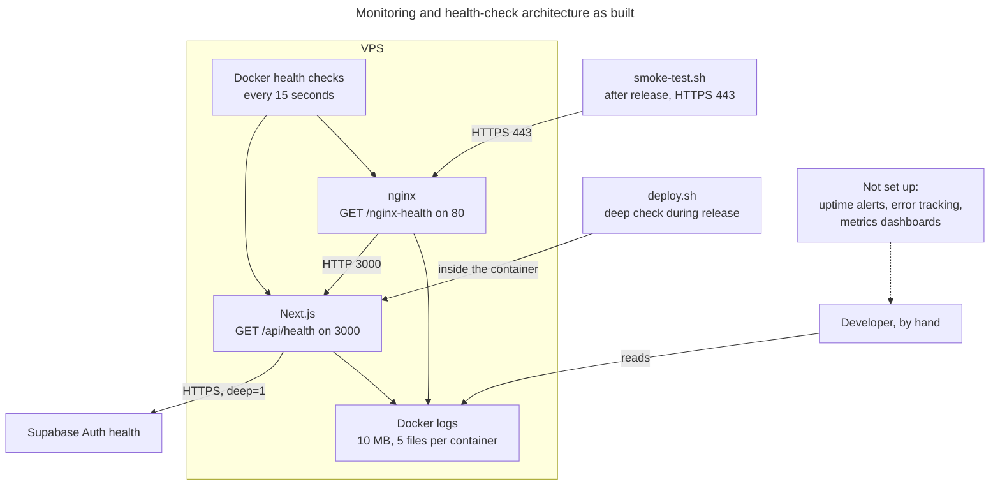

# Health, logging and monitoring

## Health endpoints

**Only one application health route exists.** `/api/health/live`, `/ready` and `/dependencies` are planned, and `/api/health/ready` returned 404 when checked.

| Check | Method | Public | Tells you | Source |
|---|---|---|---|---|
| `/api/health` | GET | Yes | The Next.js process is running, plus its version | [`route.ts`](../../src/app/api/health/route.ts) |
| `/api/health?deep=1` | GET | Yes | Also that Supabase Auth responds, within 5 seconds. Returns 503 if not | Same file |
| `/nginx-health` | GET | No, `127.0.0.1` inside the container | nginx is answering | [`internal.conf`](../../deploy/nginx/snippets/internal.conf) |
| `smoke-test.sh` | Script | Runs from anywhere | 12 outside checks on the live site | [`smoke-test.sh`](../../deploy/scripts/smoke-test.sh) |

**Why two levels:** Docker uses the shallow check. If it used the deep one, a Supabase outage would keep restarting a healthy app and make things worse.

**What isn't checked:** n8n and Google Sheets. Calling an n8n webhook could start a real workflow, so a health check can't safely do it.

## Monitoring architecture



**Reading this diagram:**
- **Docker health checks:** mark a container unhealthy and hold back nginx at startup. `unless-stopped` restarts a container that **exits**, but plain Docker doesn't restart one that's merely unhealthy.
- **Release checks:** only run during a release.
- **Between releases:** nothing watches the site automatically, as far as could be found.

## Logging

| Source | Goes to | Format | Details |
|---|---|---|---|
| Next.js | Container stdout and stderr | Plain text | Only a few `console` calls exist in the code |
| nginx | Container stdout and stderr | JSON per request | Time, IP, method, path, status, timings, user agent |
| Rotation | Docker `json-file` | 10 MB, 5 files per container | `docker-compose.yml` |
| Browser | Browser console | n/a | Not collected |

Next.js also logs unhandled errors with a short digest, the same reference shown on the error page.

**Note on privacy:** nginx logs include IP addresses and paths. Query strings aren't logged, because the format uses `$uri`.

## How to diagnose an unhealthy app

Connect to the server, then run these. They only read.

```bash
cd /srv/sidana && ./scripts/dc.sh ps
```

```bash
./scripts/dc.sh logs --tail 100 app
```

```bash
./scripts/dc.sh logs --tail 100 nginx
```

```bash
curl -s 'https://svdealflow.io/api/health?deep=1'
```

```bash
docker stats --no-stream
```

```bash
df -h /
```

| Result | Likely meaning | Go to |
|---|---|---|
| `status: ok` with `supabase: ok` | App and Supabase are fine, so look at the specific page or nginx | [Runbook](17-TROUBLESHOOTING-RUNBOOK.md) |
| `status: degraded`, 503 | The app is up but can't reach Supabase | Supabase status, `app.env` |
| "We'll be back in a moment" | nginx can't reach the app | `dc.sh ps`, app logs |
| Connection failed | nginx, the VPS or DNS | [Runbook](17-TROUBLESHOOTING-RUNBOOK.md) |

To see which version is live, read `version` in the `/api/health` response.

## What's missing

| Capability | State | Why it matters |
|---|---|---|
| Uptime alerts | None found. External tools can't be seen from here | No one is told if the site goes down |
| Request IDs | None | Hard to follow one request through logs |
| Structured app logs | None | Hard to search |
| API timing | None for the app; nginx logs timings | Slow pages go unnoticed |
| Error tracking | None | Errors are only in logs, which rotate |
| VPS and container metrics | Only by hand, and possibly Hostinger's panel | No warning before the disk or memory fills |
| Certificate expiry alert | Let's Encrypt renewal only, with no alert on failure | HTTPS could lapse |
| Backup monitoring | Backups aren't running | See the [VPS document](09-HOSTINGER-VPS-INFRASTRUCTURE.md#backups) |
| n8n failure alerts | Not verified | Data could silently stop syncing |
| Failed admin reads | Show as blanks, with no log | Team could misread missing data |

**Simplest first step:** point a free uptime monitor at `https://svdealflow.io/api/health?deep=1`.
