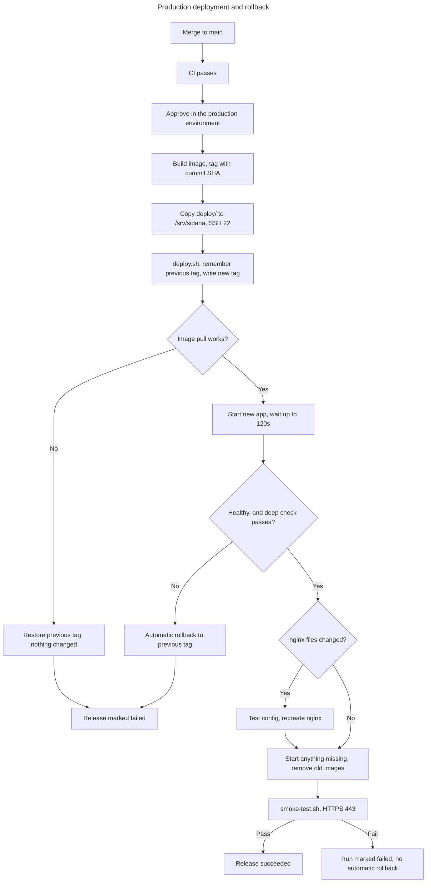

# Deployment and rollback

The first-time server setup is in [`deploy/README.md`](../../deploy/README.md). This document explains how releases work day to day.

**Deployed so far:** `d670cd5` on 30 October, then `049c111` and `0b9d15e` on 31 October. All three used this process.

## Release flow



**Reading this diagram:** the workflow steps are in [`deploy.yml`](../../.github/workflows/deploy.yml), and the server steps are in [`deploy.sh`](../../deploy/scripts/deploy.sh). The key lines are the previous tag (`:9`), rollback (`:18-29`), image pull (`:32`), starting the app (`:38`), and nginx (`:41-47`).

**Automatic rollback has never run for real,** because no release has failed that check.

**The failing nginx config case:** `nginx -t` runs under `set -e`, so a bad config stops the script before nginx is recreated. The new app stays running, and the run fails. It doesn't roll back.

## What users see

The app restarts during a release, usually within seconds. During that time nginx shows "We'll be back in a moment", which refreshes by itself. A form submitted in that moment has to be sent again. There's no zero-downtime deploy.

## How to release

1. Merge the pull request. **This doesn't deploy by itself.**
2. Wait for CI to pass on `main`.
3. Open the waiting run in the [Actions tab](https://github.com/abhinav0510/phase-1/actions).
4. Click **Review deployments**, tick `production`, then click **Approve and deploy**.
5. Confirm the version:

```bash
curl -s https://svdealflow.io/api/health
```

The `version` should be the full commit SHA you approved.

## How to roll back

The server keeps recent images for about 14 days.

1. Find the full SHA of the last good release in the Deploy run history.
2. In **Actions → Deploy → Run workflow**, enter it as `tag`, then run and approve.
3. The workflow skips the build, checks out that commit, copies its `deploy/` files and runs `deploy.sh` with that tag.
4. Confirm with `/api/health`.

**Limitations:**
- Rollback doesn't undo database changes. Migrations are applied by hand, so check whether the older version still works with them.
- The image must still be in the registry. Package retention **isn't verified**.
- It needs GitHub Actions to be working. Otherwise, an administrator can run `./scripts/deploy.sh <full-sha>` on the server after `docker login ghcr.io`, or `./scripts/dc.sh up -d app` if that image is already there and `release.env` is set to it.

## Changing settings

| Change | Steps |
|---|---|
| A server secret or `app.env` value | Edit it on the server, then `./scripts/dc.sh up -d --force-recreate app` |
| A `NEXT_PUBLIC_` value | Update it on GitHub **and** in `app.env`, then release again, because it's built into the image |
| nginx config | Change it in `deploy/nginx`, then release; `deploy.sh` tests and applies it |
| Database schema | Run the SQL by hand in Supabase, before releasing code that needs it |

## Disaster recovery

**Current state:** recovery is possible, but it has **never been rehearsed**.

### If the VPS is lost

No portal data is on it. What's lost is the settings files and the certificate.

1. Create a new Ubuntu VPS and run [`bootstrap-vps.sh`](../../deploy/scripts/bootstrap-vps.sh) as root.
2. Add the deploy key, and create `.env` and `app.env` from their [examples](../../deploy/.env.example). You'll need the secret values from their owners.
3. Update `VPS_HOST` and `VPS_KNOWN_HOSTS` on GitHub.
4. Run the Deploy workflow.
5. Point the DNS `A` record to the new server.
6. Run [`init-tls.sh`](../../deploy/scripts/init-tls.sh), then release again so the live check passes.

### If the database is damaged

| Option | State |
|---|---|
| VPS backup script | **Not running** |
| Supabase backups | Depends on the plan: **needs admin** |

**This is the biggest recovery gap.** Sort it out before founders depend on the system.

### If GitHub is down

The live site keeps running, and only new releases stop.

### If Supabase is down

Signed-in pages fail or show the last good copy. Nothing on the VPS can fix it.

## Before going further

| Item | State |
|---|---|
| Vercel | Still live. It builds from `main`, separately from this process |
| Backups and alerts | Not set up |
